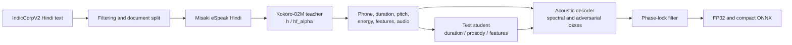

# Swarini: A Compact Single-Voice Hindi TTS Student Distilled from Kokoro-82M

**Manuscript status.** This is an experimental systems paper draft. Its results are preliminary: the repository contains no controlled Hindi listening study, no validated end-to-end Hindi benchmark, and no complete run log for the bundled ONNX checkpoint. The claims below are limited to the available artifacts and logs.

## Abstract

We study whether a compact, single-voice Hindi text-to-speech (TTS) student can be distilled from the Hindi path of Kokoro-82M. The student uses the teacher's `h` language code, `hf_alpha` voice, and Misaki's Hindi phonemizer, and contains approximately 8.08 million parameters. Training text comprises 12,000 filtered sentences from AI4Bharat IndicCorpV2; the teacher generates the acoustic and intermediate targets. The repository includes a 36.99 MB FP32 ONNX export and a 9.04 MB weight-quantized export. At 50,000 decoder updates, teacher-conditioned acoustic reconstruction on eight held-out sentences produced a mean dynamic-time-warped (DTW) log-mel L1 of 0.4886 and an unaligned log-mel L1 of 0.4899. In a separate five-utterance diagnostic, multilingual Whisper-tiny produced 116.7% word error rate (WER) and 116.0% character error rate (CER), indicating that this diagnostic does not establish reliable transcription or pronunciation quality. The results document a compact Hindi student and its training pipeline, but do not demonstrate perceptual parity with Kokoro or suitability for deployment. A controlled native-speaker evaluation and broader end-to-end testing remain necessary.

## 1. Introduction

Text-to-speech systems are often evaluated for intelligibility, naturalness, and speaker consistency, while deployment on memory-constrained devices also places a premium on model size. Teacher-student distillation offers one way to reduce a model's parameter count, but a compact student must still preserve the teacher's pronunciation and prosody in the target language. This work examines that trade-off in a deliberately narrow setting: one Hindi voice distilled from a multilingual teacher.

We build Swarini from Kokoro-82M's Hindi path (`h`) and `hf_alpha` voice. The student uses Misaki's eSpeak Hindi frontend to produce the phoneme IDs expected by Kokoro's shared vocabulary. It predicts phoneme-level duration and prosodic features, then decodes these features into a 24 kHz waveform. Training and inference code substantially adapt Paradee, an earlier Kokoro-derived single-voice student. We therefore treat the Hindi model and its corpus/profile adaptation as the subject of this study, rather than claiming a new general distillation algorithm.

This study makes three bounded contributions:

1. It documents an implemented Hindi adaptation of a Kokoro-family student pipeline, including text selection, phone validation, teacher-target generation, training stages, and ONNX export.
2. It provides FP32 and compact weight-quantized artifacts totaling approximately 8.08 million parameters, with file sizes of 36.99 MB and 9.04 MB, respectively.
3. It reports the available early evaluation evidence and its limits: teacher-conditioned decoder metrics and a five-utterance Whisper-tiny diagnostic, without treating either as a substitute for native-speaker evaluation.

The evidence does not show that Swarini matches Kokoro in naturalness or Hindi accuracy. In particular, the small ASR diagnostic has high error, and the repository does not contain results from a controlled listening study. We present the work as a compact-model case study and an evaluation-in-progress.

## 2. Background and related work

Kokoro-82M is the frozen teacher used in the reported Hindi experiment [2]. Its Hindi language path, voice conditioning, phoneme vocabulary, and 24 kHz output define the compatibility target for the student. The model is not trained from human Hindi recordings in this study; its acoustic targets are synthesized by Kokoro.

Paradee provides the principal implementation and methodological foundation [1]. Swarini retains substantial parts of its Kokoro-family student design, training stages, and inference/export path, while adding Hindi-specific text preparation, G2P validation, configuration, and packaged Hindi artifacts. This lineage is part of the method's provenance and is not presented as independent reimplementation.

AI4Bharat IndicCorpV2 supplies the Hindi text corpus [3]. Misaki's eSpeak Hindi path converts selected text into the teacher-compatible phoneme sequence [4]. IndicVoice-82M is included in the repository as an experimental teacher adapter [5], but the student reported here was trained with Kokoro and Misaki. At the pinned revisions inspected for this project, the IndicVoice v1.0 checkpoint and Kokoro v1.0 checkpoint had the same SHA-256 digest (`496dba118d1a58f5f3db2efc88dbdc216e0483fc89fe6e47ee1f2c53f18ad1e4`). Thus, these checkpoints do not support a comparison between independently trained teachers. Punjabi and Bengali configuration files are templates, not evaluated student models.

Teacher-in-the-Loop is a methodological reference [6]. The current pipeline generates and stores teacher targets before student training; it does not implement or evaluate the referenced method as an online teacher-in-the-loop procedure.

## 3. Data and teacher

### 3.1 Hindi text corpus

The corpus contains 12,000 sentences selected from the pinned AI4Bharat IndicCorpV2 revision `2d7285e6ce14fdb3fb2449c9f89427b9f582ac3f`. There are 11,800 training sentences and 200 held-out sentences. The split is document-separated: source paragraphs used for the held-out examples are excluded from training, and normalized duplicate sentences are removed across splits. Corpus metadata records source line and document hashes, sentence hashes, the selection seed, filtering counts, and split membership.

Text is normalized to Unicode NFC and filtered to retain Hindi-script content. The selection rules require at least 85% Devanagari letters, 4–45 words, 25–300 characters, terminal punctuation, and no more than four selected sentences per source paragraph. Misaki 0.9.4 with eSpeak NG Hindi validates phone coverage; examples with unknown phone symbols or sequences longer than 400 phonemes are rejected. These checks make the prepared corpus compatible with the teacher's 178-entry token-ID space, but do not establish broad dialect or domain coverage.

### 3.2 Teacher generation

The teacher is Kokoro-82M, pinned at revision `f3ff3571791e39611d31c381e3a41a3af07b4987`, with language code `h` and voice `hf_alpha` [2]. For each sentence, the pipeline stores teacher-derived phoneme IDs, duration, pitch, loudness, text features, and synthetic audio. The recordings are therefore teacher outputs, not independent human speech targets. Audio is mono at 24 kHz.

## 4. Student and training method

### 4.1 Pipeline overview

Figure 1 summarizes the offline distillation pipeline. Corpus preparation and phone validation precede teacher inference. The text student learns from teacher intermediates; the acoustic decoder learns to reconstruct teacher waveforms. The student is exported as a standalone ONNX graph and does not call the teacher at inference.

**Figure 1.** Offline teacher-student training and standalone student export.

### 4.2 Text student

The text student predicts durations, pitch, loudness, and intermediate text features from phoneme IDs. It uses a width-scaled Kokoro-family text encoder and prosody predictor, with a learned constant style vector for the single target voice. A projection maps the text representation to the teacher decoder's 512-channel feature space. The `s+mlp` preset contains approximately 4.23 million parameters.

Training minimizes teacher-supervised losses for duration, pitch, loudness, and text features. The duration loss is computed in log space; the remaining terms use L1 losses. The resulting text model can produce predicted prosody and features without teacher inputs at inference.

### 4.3 Acoustic decoder

The decoder maps predicted text features, pitch, and loudness to waveform audio using a reduced-width Kokoro-family iSTFTNet decoder. Preset A contains approximately 3.85 million parameters. Its reconstruction objective combines log-mel loss with multi-resolution short-time Fourier transform (STFT) losses. Two adversarial refinement stages are included in the configured recipe, with a multi-period and multi-resolution discriminator and feature-matching loss.

The default full recipe requests 8,000 text-student updates, 50,000 decoder updates, and two 5,000-update adversarial stages. CUDA runs use batch sizes 32, 16, and 8 for the text, decoder, and adversarial stages, respectively. These are pipeline settings; they should not be interpreted as independently validated optimal hyperparameters.

### 4.4 Export and compact weights

The export combines the text student, decoder, and parameter-free phase-locking filter into one ONNX graph. The FP32 model contains approximately 8.08 million learned parameters. The compact export quantizes large weight matrices to per-output-channel INT8, stores selected smaller tensors in FP16, and reconstructs fixed DFT bases in the graph. It is therefore a mixed-precision, weight-quantized export rather than a fully INT8 network.

## 5. Experimental setup and results

### 5.1 Artifacts and size

Table 1 reports artifact measurements from the files included in the repository. The nominal teacher parameter count is approximately 82 million [2]; the student has about 90.1% fewer parameters by this count. The compact ONNX file is 75.6% smaller than the FP32 export. These are size comparisons, not quality comparisons.

**Table 1. Model parameter and file-size measurements.**

| Artifact | Parameters | File size | Precision and evidence |
|---|---:|---:|---|
| Kokoro-82M teacher | ~82M | Not measured here | Frozen teacher |
| Swarini FP32 ONNX | ~8.08M | 36.99 MB | FP32 export; informal listening notes only |
| Swarini compact ONNX | ~8.08M | 9.04 MB | INT8 matrices with selected FP16 tensors; no separate listening result recorded |

### 5.2 Teacher-conditioned decoder reconstruction

At decoder step 50,000, the training log reports DTW log-mel L1 of 0.4886 and raw log-mel L1 of 0.4899 on eight held-out sentences. These values are calculated after RMS normalization; DTW compares 80-bin log-mel frames along a monotonic alignment path. The evaluation feeds teacher-derived text features, pitch, and loudness to the student decoder. It therefore measures decoder reconstruction under teacher conditioning, not the complete student text-to-waveform system. The raw training log is not included in this checkout, limiting independent verification of this run.

### 5.3 Exploratory end-to-end ASR diagnostic

A separate spot check synthesized five short prompts with the FP32 export and transcribed them using multilingual Whisper-tiny with Hindi specified as the language. After Unicode-aware normalization, this diagnostic yielded 116.7% WER and 116.0% CER. For the prompt `नमस्ते, आप कैसे हैं?`, the recognizer returned `namaste you kasi hai`. Whisper-tiny produced mostly garbled transcripts in this sample. Because this check contains only five utterances and uses an imperfect recognizer, it is not a validated benchmark of TTS quality; the high error nevertheless prevents a positive Hindi-accuracy claim from this evidence.

### 5.4 Evaluation not yet completed

The repository does not report a controlled native-speaker listening test, MOS, preference scores, confidence intervals, a validated Hindi ASR benchmark, speaker-similarity results, or a broad end-to-end comparison against the teacher. It also does not retain full training checkpoints or the complete log associated with the bundled ONNX files. The decoder metrics above should be treated as a training-stage diagnostic, not as a final evaluation of the exported checkpoint. Evaluation on all 200 held-out sentences, paired teacher/student listening, and reproducible end-to-end measurements remain necessary.

### 5.5 Reproducibility details

The training environment is defined by the repository's Python 3.12 project and lockfile, and the recorded training commands used CUDA. The checkout does not preserve the exact GPU model, driver and runtime versions, full pipeline log, or the checkpoints used to produce the bundled exports. The source, configuration, corpus, and artifacts are available, but the precise export lineage cannot be reconstructed from this checkout alone. A final experimental release should archive the run manifest and logs, checkpoint and artifact hashes, and hardware/software versions.

## 6. Limitations and discussion

This study is restricted to one voice and one language path. Teacher-generated targets inherit the teacher's pronunciation, voice characteristics, and errors; they do not provide independent evidence of human-like Hindi speech. The text corpus is document-separated but small and selected through script and length filters, and may underrepresent dialects, code-switching, names, and out-of-domain vocabulary.

The available decoder metrics assess acoustic reconstruction with teacher-derived inputs. They do not show how errors in the student text model affect end-to-end synthesis. The five-prompt Whisper-tiny result is too small and recognizer-dependent for a quality estimate, but its high error is a concrete warning that the current Hindi output needs stronger evaluation. File-size reduction alone does not establish practical edge performance; latency, memory, and listening quality have not been reported under a specified hardware protocol.

The method also inherits substantial design and implementation from Paradee [1]. Swarini's contribution is the Hindi-specific adaptation, curated and phone-validated corpus, teacher configuration, compact exports, and the documented evaluation status. The repository contains profile-driven scaffolding for other Indic languages, but only the Hindi Kokoro profile is a completed end-to-end result. Other teachers must match the student architecture's 24 kHz feature and decoder interface, and each language requires validated G2P phone coverage; Punjabi and Bengali profiles are not evidence of multilingual generalization.

## 7. Conclusion

We document Swarini, an approximately 8.08-million-parameter single-voice Hindi student distilled from Kokoro-82M's `hf_alpha` voice. The repository provides FP32 and mixed-precision weight-quantized ONNX exports, at 36.99 MB and 9.04 MB. A decoder-only held-out diagnostic reports DTW log-mel L1 of 0.4886 at 50,000 updates, while a five-utterance Whisper-tiny check reports high WER and CER. Together, these results establish the presence of a compact Hindi TTS artifact and a documented training path, but do not establish Hindi speech quality or parity with the teacher. A controlled native-speaker study, comprehensive end-to-end evaluation, complete run provenance, and hardware-specific speed and memory measurements are required before making deployment or quality claims.

## References and software sources

[1] S. Mahendrakar. *Paradee: Distilling Kokoro-82M into an 8M-Parameter Single-Voice Text-to-Speech Model*. Project and paper, 2026. <https://github.com/sahilmahendrakar/paradee>.

[2] Hexgrad. *Kokoro-82M*. Model repository. <https://huggingface.co/hexgrad/Kokoro-82M>.

[3] S. Doddapaneni et al. “Towards Leaving No Indic Language Behind: Building Monolingual Corpora, Benchmark and Models for Indic Languages.” *Proceedings of ACL 2023*, 2023. <https://aclanthology.org/2023.acl-long.693/>. Dataset: <https://huggingface.co/datasets/ai4bharat/IndicCorpV2>.

[4] Hexgrad. *Misaki*. Grapheme-to-phoneme package. <https://github.com/hexgrad/misaki>.

[5] K. K. Bind. *IndicVoice-82M*. Model repository. <https://huggingface.co/Bindkushal/IndicVoice-82M>.

[6] *Teacher-in-the-Loop: Reliable Distillation of Kokoro-82M into 8M-Parameter Single-Voice Students, in English and Italian*. Project repository. <https://github.com/MithrilMan/teacher-in-the-loop>.
